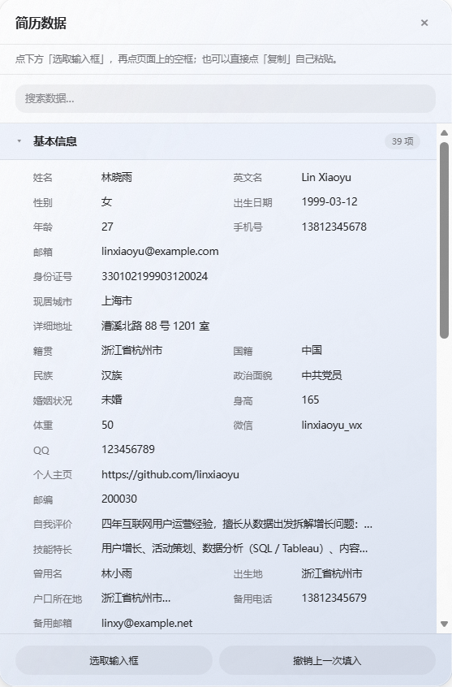
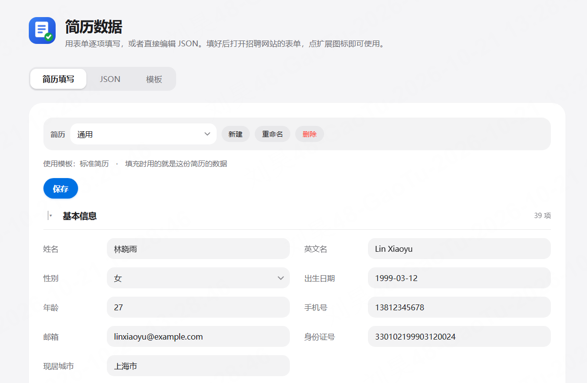
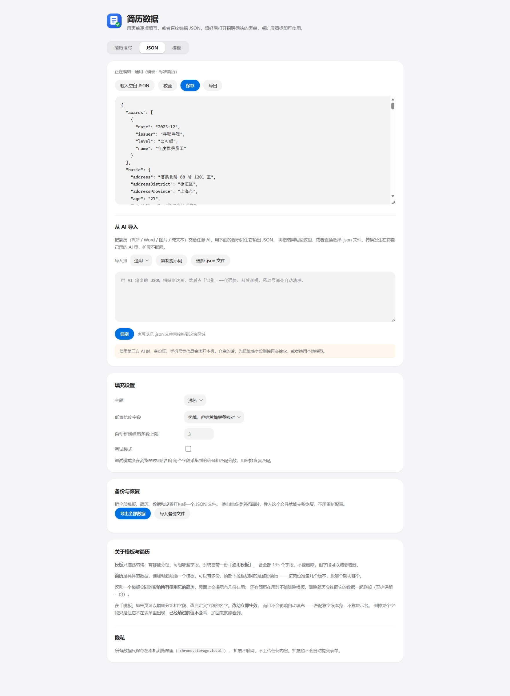
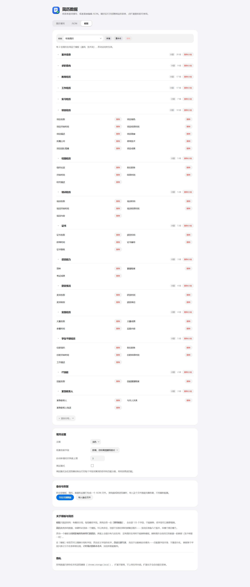
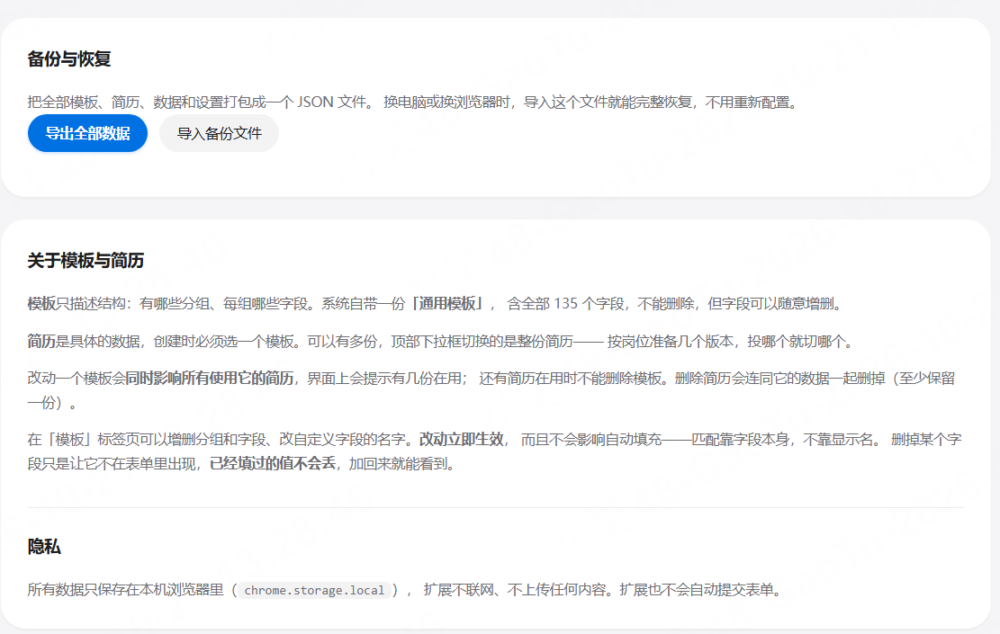

# 简历自动填写

> 把一份结构化简历填进任意网站的求职表单。纯本地运行，不联网，不上传。

投简历最烦的往往不是写简历，而是同一份信息在几十个网站的表单里反复手填：
姓名、手机、教育经历、项目描述……每个站的字段名和排版还都不一样。

这个扩展把简历整理成一份结构化数据，用两种方式填进去：

- **自动填充** —— 按 DOM 多信号打分，推断每个输入框对应哪个字段
- **数据面板（推荐）** —— 把简历摊在页面右侧，点输入框、再点数据，直接填

不用为每个网站写适配规则，也**不会自动提交**——填完由你自己核对再点提交。

纯规则实现，没有 LLM 调用，没有网络请求。

### 特点

- 🔒 **数据只在本地**：`chrome.storage.local`，无任何网络请求，不用 `storage.sync`
- 🗂 **多份简历 + 模板**：模板描述结构，简历持有数据，按岗位切换
- 🖱 **数据面板**：拿不准的字段不用教引擎，自己点一下就行
- 🤖 **从 AI 导入**：把 PDF / Word / 图片交给任意 AI，转成 JSON 一键导入
- 💾 **整包备份**：模板、简历、设置打成一个文件，换电脑直接恢复
- 🧪 **207 项自动化测试**：匹配引擎、区块消歧、填充器、导入、存储

### 截图

**简历数据面板**：页面右侧常驻，点输入框、再点数据就能填入



| 扩展弹窗 | 简历填写 |
|---|---|
|  |  |

<details>
<summary><b>更多截图</b>：JSON 导入 / 模板编辑 / 备份与恢复</summary>

**JSON 标签页**：可以直接编辑，也可以把 AI 转换的结果粘进来或拖入文件



**模板编辑**：增删分组和字段，改动立即生效



**备份与恢复**：全部模板、简历和设置打包成一个文件



</details>

---

## 安装

1. 打开 `chrome://extensions`
2. 右上角打开「开发者模式」
3. 点「加载已解压的扩展程序」，选中本目录

### 要打开本地测试页，必须多做一步

`test/test-form.html` 是 `file://` 页面，Chrome 默认**不允许扩展访问本地文件**。
必须手动开启：

1. `chrome://extensions` → 找到「简历自动填写」→ 点**「详情」**
2. 找到「**允许访问文件网址**」，打开开关
3. **回到测试页按 F5 刷新**

不开这一步，扩展根本不会注入到该页面，popup 会提示「请在扩展详情页打开『允许访问文件网址』」。

### 改完代码之后

1. 在 `chrome://extensions` 点扩展卡片上的**刷新按钮**
2. **回到网页按 F5**

第 2 步很容易忘：manifest 里声明的 content script 只在**页面加载时**注入一次，
重载扩展不会把它重新注入到已经打开的标签页。只做第 1 步的话，页面上跑的还是旧代码。

**没有构建步骤**，改完刷新即可。

---

## 使用

### 1. 填简历数据

点扩展图标 → 「编辑简历数据」，页面顶部有三个标签页：简历填写 / JSON / 模板。

#### 表单填写（推荐）

按模块逐项填，不需要碰 JSON：

- **15 个模块**：基本信息、求职意向、教育、工作、实习、项目、校园、培训、
  证书、语言、获奖、实践、学生干部、IT 技能、紧急联系人
- **经历类模块**可以「+ 添加一条」和「删除」，按顺序对应页面上的第 1、2、3 条
- **固定选项用下拉框**：性别、学历、政治面貌、婚姻状况等，不会打错字
- 用不到的留空即可，留空的字段填充时会被跳过

#### 模板与简历

这里有两个概念：

- **模板** —— 只描述结构：有哪些分组、每组哪些字段。系统自带一份 **「通用模板」**，
  包含全部 135 个字段，不能删除，但字段可以随意增删。
- **简历** —— 一份具体的数据，创建时必须选一个模板。可以有**多份**，各自独立。

顶部「简历」下拉框切换的是**整份简历**，填充时用的就是当前这份的数据。

```
简历  [ 通用简历 ▾ ]  [新建] [重命名] [删除]
```

| 按钮 | 作用 |
|---|---|
| 新建 | 选一个模板、起个名字，得到一份空简历 |
| 重命名 | 改这份简历的名字 |
| 删除 | 删掉这份简历**和它的数据**（至少保留一份） |

**模板**在「模板」标签页管理：新建、重命名、删除。

| 操作 | 说明 |
|---|---|
| 删除分组 | 比如应届生不需要「工作经历」，直接去掉 |
| 添加内置分组 | 从内置的 15 个里挑一个加回来 |
| **新建自定义分组** | 分组名和字段名都由你自己起，见下 |
| 删除字段 | 只让它在表单里不出现，**已填的数据不会丢** |
| 添加字段 | 内置分组从该组的字段里挑；自定义分组直接加一个空字段 |

改动一个模板会**同时影响所有使用它的简历**，界面上会提示有几份在用；
还有简历在用时不允许删除模板。内置模板不能删，但字段可以改。

**内置分组和字段的名字是固定的，不能改。** 把「手机号码」改成「联系方式」只会让你自己
对不上号，而这个字段本来就已经被同义词表覆盖了——想换个说法来匹配，改名字也帮不上忙。

#### 自定义分组

内置的 135 个字段覆盖不到的东西，用自定义分组装（在「模板」标签页里加）：

1. 「＋ 添加分组…」→ **＋ 新建自定义分组**
2. 给分组起个名字
3. 「＋ 添加字段」→ 在字段名输入框里写你要的名字
4. 切回「简历填写」填值

这类字段**不参与自动填充**（没有同义词表可匹配），但会出现在数据面板里，
可以用「选取输入框 → 点数据」手动填进去，也可以点「复制」自己粘贴。

删掉的字段加回来，之前填过的值还在。

结构的改动**立即生效**，不用点保存；「保存」只负责保存你填的数据。

#### JSON（给技术用户）

直接编辑整份数据，支持「载入空白 JSON」「校验」「导出」。

两个视图**共享同一份数据**：切到 JSON 会把当前表单序列化过去，切回表单会解析 JSON 回来。
JSON 有语法或校验错误时不允许切走，避免静默丢数据。

完整格式参照 [`test/sample-profile.json`](test/sample-profile.json)（一份填好的虚构样例），
纯空结构在 [`test/template-profile.json`](test/template-profile.json)。

#### 从 AI 导入（已有简历文件的人）

不用一条条手抄。把 PDF / Word / 图片 / 纯文本交给**你自己常用的 AI**，
让它转成我们要求的 JSON，再导进来：

1. 在 JSON 标签页点 **「复制提示词」**——提示词按当前简历所用模板的字段生成，改字段会自动跟着变
2. 粘到任意 AI（ChatGPT / Claude / 豆包 / 本地模型都行），附上你的简历
3. 把结果**粘回导入框**，或者**选择 / 拖入 .json 文件**；导入目标可以选任意一份简历，也可以「＋ 新建一份简历…」
4. 点「识别」→ 看预览 → 选「覆盖现有数据」或「只填补空字段」

「识别」会自动清理 AI 常犯的毛病：代码块围栏、前后说明、中文引号、尾逗号、
没加引号的键；再把数字转成字符串、单个对象包成数组、`2021年7月` 归一成 `2021-07`；
如果 AI 没用我们的 key 而是写了中文键（比如「姓名」），会按同义词表映射回去。

预览里会列出：识别到多少字段、修正了什么、哪些键不认识被忽略、有没有格式错误——
有格式错误时一条都写不进去。

> 转换发生在你自己的 AI 里，扩展本身仍然不联网。
> 但身份证、手机号这类信息会离开本机，介意的话先把敏感字段删掉再交给它。

#### 几个约定

- **日期**写成 `2020-07` 或 `2020-07-15`。写「去年九月」这类会被校验拦下并报错，
  因为格式错了匹配时会静默失配，极难排查。
- **`availableFrom`（到岗时间）是例外**，它填的经常是「一个月内」这类文字，不按日期校验。
- **数组类区块**（`educations` / `works` / …）按页面上第 1、2、3 条的顺序对应。
  简历里写了 3 段工作但页面只显示 1 条时，扩展会自动点「添加」把其余几条克隆出来。
- **下划线开头的键**（如 `_说明`）当作注释忽略，JSON 不支持注释，这是替代做法。
- **`hometown` 与 `hukou` 是两回事**：前者是籍贯，后者是户口所在地，国内人事表里通常是两个格子，别写混。
- **社保、银行卡这类信息不在简历字段里**——那属于入职材料，不是简历。

### 2. 填充

**推荐用法是「简历数据面板」**——把简历摊开在页面右侧，你自己指哪个填哪个：

1. 点扩展图标 → **简历数据面板**，页面右侧滑出 560px 的侧栏
2. 点面板底部的 **「选取输入框」**
3. 点页面上一个空的输入框（会被高亮）
4. 点面板里对应的数据 → 填进去

面板按**模块 → 条目 → 字段**三层展示：

```
▾ 基本信息                       12 项
      姓名        张三          [复制]
      手机号码    13800138000   [复制]
▸ 教育经历                        8 项
▸ 工作经历                       14 项
```

点模块标题可以**展开/收起**，**默认全部展开**——先看全貌，再把不关心的折起来。
滚动时模块标题会吸顶。展开状态在本次会话内保持。

反着来也行：先点数据（面板会提示「已选定…点页面上的输入框」），再点输入框。

每一项右边都有**复制**按钮，不想让扩展碰那个框，就复制了自己粘贴。

面板底部有**撤销上一次填入**——手动一个个填的时候，一键全撤太重了。

> 为什么以手动为主：让引擎去猜「这个框是什么字段」，猜错的代价是**静默填错**；
> 让人来指，代价只是**多两下点击**，而且错了立刻看得见。

**「自动填充」**是另一条路——引擎按区块和标签自动匹配，一次填满能填的。
当页面上字段很多、你不介意逐个核对时更快。两条路可以混用：
先自动填一遍，剩下的用数据面板补。

页面右下角还有一个**悬浮按钮**（只在看起来像简历 / 网申表单的页面出现）：
点开是首页卡片，里面能直接切换当前简历、打开数据面板、自动填充。按钮可以拖着走。

自动填充会高亮填过的字段，右下角浮出结果面板（含全部撤销）。
没认出来的框会标**紫色虚线**，提醒你这里需要手动处理。

**「预览匹配」** —— 只分析不写入，列出「哪个字段会填成什么」，用来核对。

### 3. 数据面板的细节

面板底部有两个按钮：

| 按钮 | 作用 |
|---|---|
| **选取输入框** | 进入选取模式，鼠标移到输入框上会高亮，点一下选中它 |
| **撤销上一次填入** | 只回退最近一次，比全部撤销更顺手 |

选取模式下：

| 操作 | 作用 |
|---|---|
| 点输入框 | 把它设为待填目标，面板显示「已选中输入框」 |
| 点面板里的数据 | 填入当前选中的目标；没有目标时，反过来先锁定这条数据 |
| 点「复制」 | 复制内容，自己粘贴 |
| `Esc` | 退出选取模式 |

**没有任何东西被记住。** 刷新页面后一切归零，每次重新开始。
好处是不用处理「记住的选择器失效了怎么办」这一整类麻烦。

### 4. 备份与恢复

选项页最下方有「备份与恢复」：

- **导出全部数据** → 下载 `resume-assistant-backup.json`，里面是全部模板、简历、数据和设置
- **导入备份文件** → 校验结构、二次确认后整体覆盖

换电脑或换浏览器时，导入这个文件就完整恢复了，不用一份份重新配。
注意导入是**整体覆盖**，不是合并——它会恢复成导出时的样子。

### 5. 排查误匹配

选项页打开「调试模式」，然后在页面上填充时打开浏览器控制台，
会打印一张表，列出每个字段采集到的信号（标签、来源、placeholder、区块）和最终匹配结果。

---

## 扩展不会做什么

**不会自动提交表单。** 只填内容，提交按钮由你自己核对后点。投简历是对外动作，
填错内容自动投出去是不可接受的。

**不联网。** 所有数据只存在本机 `chrome.storage.local`，用的不是 `storage.sync`，
所以身份证号、手机号不会同步到任何服务器。

---

## 测试

```bash
node test/engine.test.js   # 匹配引擎与区块识别（65 项）
node test/smoke.test.js    # 模块加载、词表自洽、填充器、面板、主题、模板简历、悬浮按钮判定（104 项）
node test/import.test.js   # 导入：容错解析、归一化、提示词生成（22 项）
node test/storage.test.js  # 模板 / 简历 / 数据、备份与迁移（15 项）
```

`test/engine.test.js` 直接构造描述符对象喂给打分器，不需要浏览器。
覆盖的都是「不特意处理就一定会错」的场景：区块消歧、反向别名、枚举指纹、
全局分配、类型约束、区块标题与字段标签的区分。

`test/smoke.test.js` 按 manifest 里的顺序加载全部模块，检查导出契约、跨模块引用、
词表自洽（含**同一别名不得被两个字段声明**这条硬约束），以及
**每份简历里的每个字段都必须有对应的匹配规则**——不然后者会静默失效，最难发现。

`test/import.test.js` 专门喂「AI 不守规矩」的输入：代码块围栏、前后废话、
中文引号、尾逗号、裸键、数字、单对象、中文 key、各种日期写法。

`test/test-form.html` 是手工回归测试页，用浏览器打开，覆盖：
标准 `label[for]`、表格布局、拆分日期、只有 placeholder、单选组、可重复块、
模拟 React 受控组件（验证 `_valueTracker` 那条路径）、登录表单与验证码框（应被跳过）。

---

## 架构

```
manifest.json
src/
  shared/
    00-ns.js        建立 globalThis.RA 命名空间（必须第一个加载）
    normalize.js    文本归一化与别名匹配
    fields.js       字段词表：强别名 / 弱别名 / 反向别名 / autocomplete 映射
    storage.js      数据存取与校验
    importer.js     导入：容错解析、归一化、提示词生成
  background/
    service-worker.js  只用来替内容脚本打开选项页
  content/
    10-scan.js      DOM 扫描，采集每个控件的语义信号
    20-section.js   区块识别、重复块拆分、拆分日期检测
    30-score.js     打分与全局分配
    40-fill.js      填充器（各类控件）
    50-overlay.js   页面内全部浮层：结果面板、高亮、数据面板样式
    60-pick.js      输入框选取模式（高亮、事件拦截）
    70-datapanel.js 简历数据面板
    90-main.js      入口与消息路由
  popup/            点扩展图标：数据面板 / 自动填充 / 预览
  options/
    options.html    表单 / JSON / 设置
    options.js      简历渲染与字段编辑、双视图同步
test/
  engine.test.js    引擎单元测试
  smoke.test.js     加载与词表自洽测试
  import.test.js    导入解析与归一化测试
  storage.test.js   多份简历数据的存取与迁移测试
  test-form.html    手工回归测试页
  icon-preview.html 图标在四种尺寸和深浅背景下的预览
icons/              扩展图标（16 / 32 / 48 / 128）
tools/
  make-icons.js     重新生成图标（改颜色/形状后运行 node tools/make-icons.js）
```

### 为什么没有构建步骤

MV3 的 content script **不支持静态 `import`**（[w3c/webextensions#156](https://github.com/w3c/webextensions/issues/156) 提过提案但从未落地）。
但同一个 `content_scripts` 条目里 `js[]` 数组的多个文件**共享同一个 isolated world 作用域，并按数组顺序执行**。

所以所有模块都挂在 `globalThis.RA` 上，加载顺序由 manifest 控制。
改名或增删模块时**必须同步改 manifest 里的 `js` 数组顺序**。

### 匹配是怎么做的

每个控件从这些地方采集语义信号，按可靠性加权：

| 信号 | 权重 |
|---|---|
| `autocomplete` 标准 token | 100 |
| `<label for>` | 90 |
| `<legend>` | 88 |
| 包裹式 `<label>` | 85 |
| `aria-labelledby` | 80 |
| `aria-label` / 框架标签类名 | 76–78 |
| 描述性 `placeholder` | 70 |
| 表格单元格 / 表头 | 64 |
| 容器内前置文本 | 60 |
| 几何相邻文本 | 56 |
| `name` 属性 | 55 |
| `id` 属性 | 50 |

打分用**主导证据 + 佐证**，不是简单求和：

```
raw = 最大值 + 0.35 × 其余之和
```

这样一个权威的 `<label for>手机号码</label>` 不会被一堆弱信号累加盖过。
之后依次乘上类型约束、`maxlength` 先验、区块修正系数。

最后做**全局贪心分配**：所有「控件 × 字段」候选对按分数降序占用，
保证一个控件只填一个字段、一个字段（在同一条经历里）只占一个控件。

### 区块消歧

「开始时间」这四个字本身没有意义——在教育经历下是入学时间，在工作经历下是入职时间。

区块识别从字段向上回溯标题（`h1`–`h6`、`legend`、`class` 含 `title`/`heading` 的元素、
表格表头），把标题文字归类到区块。找不到标题时，用同容器里邻居字段的匹配结果投票推断。

匹配时区块相符乘 1.12，经历类区块之间错配乘 0.12。

### 拆分日期

`年 / 月 / 日` 三个独立控件在简历表单里极其常见，且标签通常只挂在第一个控件上。

`20-section.js` 会识别这种组（依据标签文字含 年/月/日、`maxlength`、
下拉选项是否像年份/月份），合并成一个虚拟的 `date-cluster` 字段，
组内其余控件标记为已消费，不再单独参与匹配。写入时把日期拆开分发到各格。

### 填充时的两个关键细节

**React 受控组件。** 直接 `el.value = x` 会被 React 的实例级 value 拦截器认为是「没变化」，
`onChange` 不触发，提交时值是空的。必须先绕过原型 setter 写值，再把 tracker 推回旧值：

```js
Object.getOwnPropertyDescriptor(HTMLInputElement.prototype, 'value').set.call(el, value);
el._valueTracker?.setValue(prev);   // 让 React 察觉差异
el.dispatchEvent(new InputEvent('input', { bubbles: true }));
```

**`blur` 不冒泡。** 站点的委托式校验监听的是 `focusout`，派发 `blur` 事件根本到不了它那儿。

**绝不要「先赋值、再调 `setNativeValue`」。** 那个函数开头有「值没变就早退」的判断，
先写值会让它直接返回，**`input` / `change` 一个都不发，React 的 tracker 也不会被推回旧值**。
表现是「界面上看着填上了，提交时是空的」——最难发现的一类故障。

这个坑踩过两次：下拉框（先写 `sel.value`）和单选按钮（先写 `el.checked`，而
`setNativeValue` 写的是 `value`，单选按钮的 value 根本不变）。所以单选走
`setNativeChecked`，它专门对 `checked` 做同样的一套：绕过原型 setter + 推回 tracker + 派发事件。

填充后会在 90ms 再回读一次确认没被框架重渲染冲掉，冲掉则重试一次，再失败就如实标记为失败。

---

## 已知限制

**`::before { content: "姓名" }` 这类伪元素标签对 DOM 不可见**，自动模式下读不到，
只能靠几何位置或 `name` 属性猜。**数据面板**可以绕过这个问题——用户直接用眼睛
认出来是哪个框，在面板里点一下对应的数据就行，不需要 DOM 里有任何证据。

**自定义组件库（Ant Design / Element UI / Arco 等）是最大的失败来源。** 它们的选择器
本质是 `<div>`，需要模拟点击展开再点选项，时序和版本强相关。目前的处理策略是
优先「打字」而不是「点日历格子」，优先 ARIA listbox 而不是厂商私有类名，
每一步都有超时，认不出来就放弃并标记——绝不卡住整个流程。

**省市区三级联动**基本填不了，需要逐级点击。v1 会尽力填第一级。

### 预期命中率

纯规则方案在**从未见过的站点**上：

| 部分 | 一次命中率 |
|---|---|
| 基本信息（原生控件） | 85–90% |
| 基本信息（AntD / Element UI） | 60–70% |
| 经历类重复块 | 50–70% |
| 省市区三级联动 | 低 |

剩下的靠人工补。这是纯规则方案的真实上限——设计目标就是
「**有把握的直接填，没把握的标出来，剩下的手填**」，
而不是假装能 100% 填满然后往身份证号里写错东西。

---

## 许可证

[MIT](LICENSE) © 2026 duriansu717
